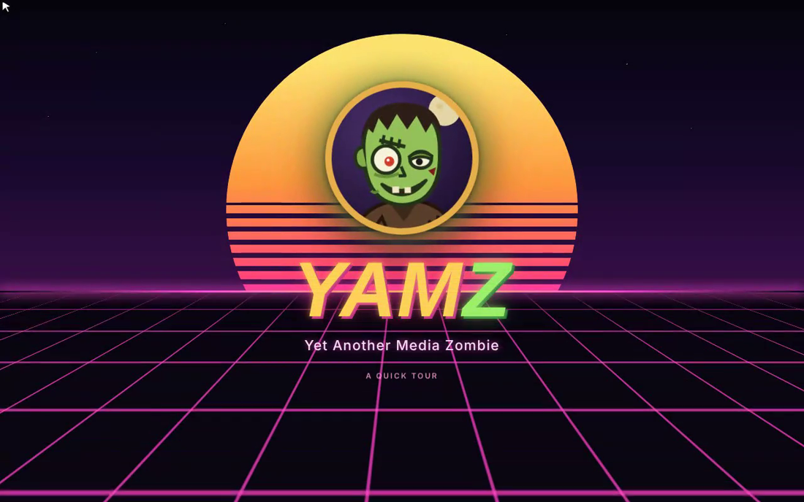
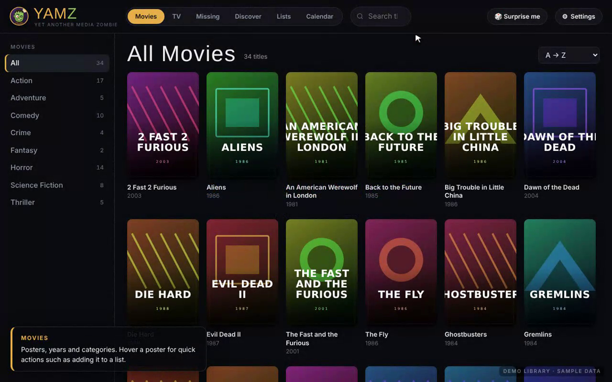
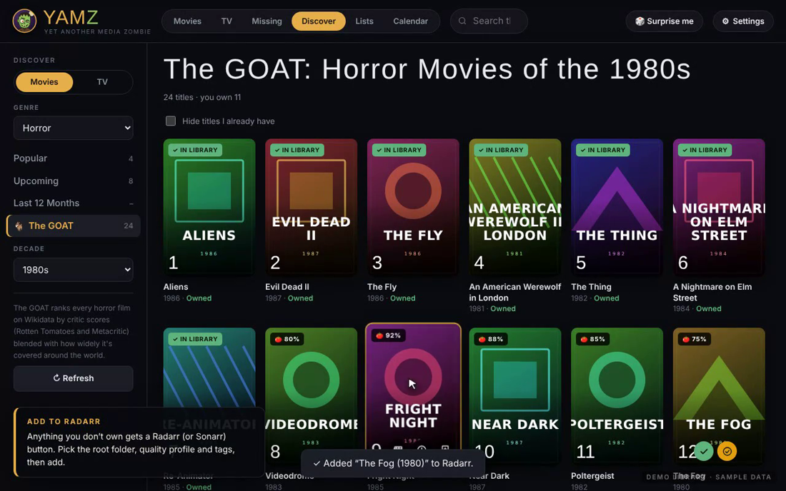
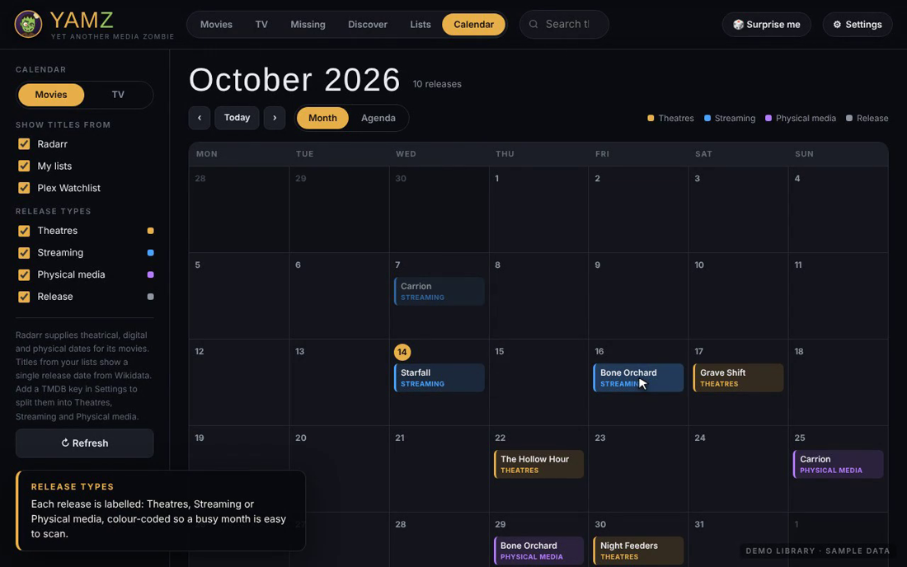
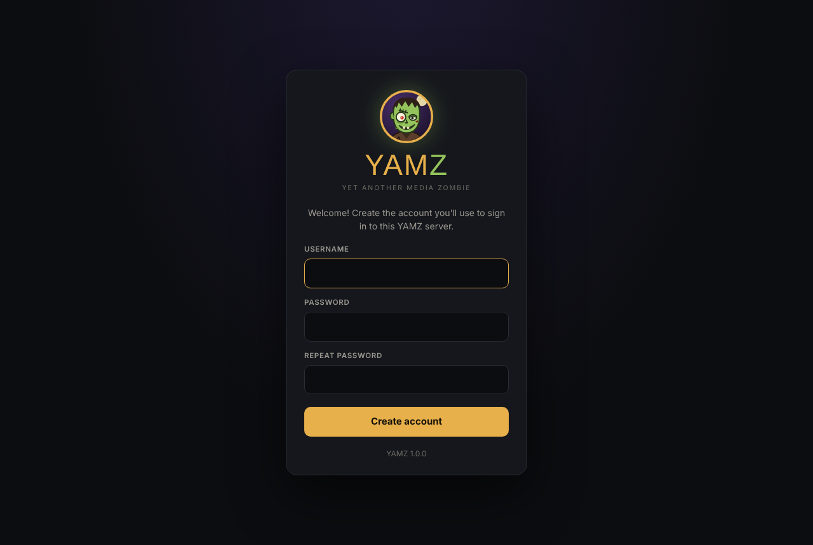

<p align="center"></p>

# YAMZ — Yet Another Media Zombie

*A "vibe coded" media manager.*

<p align="center"><a href="https://zombifiedturkey.github.io/YAMZ/"><b>▶ Try the live demo</b></a> — runs entirely in your browser with a sample library (sign in with <code>demo</code> / <code>zombies123</code>).</p>

A good-looking, self-hosted browser for your movie and TV collection. Point it at **Plex** or **Jellyfin** and get a poster wall with ratings, cast and photos — plus tools for finding what you're missing, discovering what to watch next, tracking releases, and sending titles to **Radarr** and **Sonarr**.

Run it as a **Docker container** (Unraid, Synology, any Linux box) and use it from any browser on your network or through a reverse proxy — or just open the single **`YAMZ.html`** file.

| | |
|---|---|
|  |  |
|  |  |

## Features

- **Library** — Plex and/or Jellyfin (or plain folders), merged and de-duplicated. Posters, genres, ratings from several sources, cast, photos and a *Play in Plex/Jellyfin* button.
- **TV** — seasons and episodes you have vs. what exists, with episode lists and descriptions (via TVmaze).
- **Gaps** — search for any movie or show and add it to a list, Plex Watchlist, Radarr or Sonarr; incomplete franchises/collections (missing films first), your most-watched actors and the films of theirs you don't own, and TV shows with missing seasons or episodes.
- **Discover** — Popular, Upcoming and Recent (last 1–12 months) for movies or TV, filterable by genre. Pick a genre to unlock **Essentials**: the greatest titles in that genre, all time or by decade.
- **Lists** — your own lists (marathons, shopping lists, films to lend a mate), plus your **Plex Watchlist** synced alongside.
- **Calendar** — month or agenda view of upcoming releases for everything in Radarr, Sonarr, your lists and your Plex Watchlist, labelled *Theatres*, *Streaming* or *Physical media* (episodes for TV).
- **Connections** — Plex Watchlist, Radarr and Sonarr (documented v3 API only: look up and add titles with your root folder, quality profile, tags and monitoring options).
- **Make it yours** — dark, light, auto or **Glass** theme (frosted panels with an ambient glow that follows the poster you're on), 9 accent colours, 5 poster sizes, rounded or square corners, and a side menu that can auto-hide.
- **Server mode** — built-in sign-in, settings shared across every device, backups, and requests to your LAN servers relayed by YAMZ (no CORS or mixed-content problems behind https).

No API keys are required. Metadata comes from Wikipedia/Wikidata and TVmaze; a free **TMDB** key gives richer data and theatrical/digital/physical release dates.

---

## Install with Docker

```bash
docker run -d --name yamz \
  -p 7979:7979 \
  -v /path/to/appdata/yamz:/config \
  -e PUID=1000 -e PGID=1000 -e TZ=Australia/Brisbane \
  --restart unless-stopped \
  ghcr.io/zombifiedturkey/yamz:latest
```

Then open `http://<server-ip>:7979` and create your account.

Or with Compose — see [`docker-compose.yml`](docker-compose.yml).

### Unraid

Until YAMZ is listed in Community Applications, add the template by hand. (Unraid 6.10 and later no longer have a *Template repositories* box.)

1. Open a terminal (the **>_** icon at the top right of the Unraid web UI) and run:
   ```bash
   wget -O /boot/config/plugins/dockerMan/templates-user/my-YAMZ.xml \
     https://raw.githubusercontent.com/zombifiedturkey/YAMZ/main/unraid/yamz.xml
   ```
2. **Docker** tab → **Add Container** → in the **Template** dropdown pick **YAMZ** (under *User templates*) → **Apply**.
3. Click the YAMZ icon → **WebUI**, and create your account.

Appdata defaults to `/mnt/user/appdata/yamz`, running as `99:100` (nobody:users).

### Settings (environment variables)

| Variable | Default | What it does |
|---|---|---|
| `PORT` | `7979` | Port inside the container. |
| `PUID` / `PGID` | `99` / `100` | User/group YAMZ runs as and owns `/config`. |
| `TZ` | `Etc/UTC` | Timezone for logs. |
| `YAMZ_AUTH` | `on` | `none` turns off YAMZ's own sign-in — **only** if your reverse proxy already requires a login (Authelia, Authentik…). |
| `YAMZ_TRUST_PROXY` | `false` | `true` when behind a reverse proxy: secure cookies over https and real client IPs for sign-in rate-limiting. |
| `YAMZ_ALLOW_SELF_SIGNED` | `false` | `true` if Plex/Jellyfin/Radarr/Sonarr use https with self-signed certificates. |
| `YAMZ_BASE_PATH` | *(empty)* | Only if your proxy serves YAMZ under a sub-folder **without** stripping it, e.g. `/yamz`. |
| `YAMZ_USER` / `YAMZ_PASSWORD` | *(empty)* | Optional: create the first account automatically instead of the setup screen. |
| `YAMZ_SESSION_DAYS` | `30` | How long a sign-in lasts. |

### Reverse proxy

YAMZ works behind SWAG, Nginx Proxy Manager, Traefik or Caddy on its own (sub)domain. Set `YAMZ_TRUST_PROXY=true`.

```caddy
yamz.example.com {
    reverse_proxy 192.168.1.10:7979
}
```

```nginx
location / {
    proxy_pass http://192.168.1.10:7979;
    proxy_set_header Host $host;
    proxy_set_header X-Forwarded-Proto $scheme;
    proxy_set_header X-Forwarded-For $proxy_add_x_forwarded_for;
}
```

Because YAMZ relays requests to Plex, Jellyfin, Radarr and Sonarr itself, those servers can stay on plain http on your LAN — the browser only ever talks to YAMZ.

---

## The standalone file

`YAMZ.html` is the whole app in one file. Download it, open it in Chrome, Edge or Firefox, and connect your library — no install. Everything is stored in that browser.

- To move to the Docker version: **Settings → Backup → Download backup** in the file, then **Restore backup** in the server.
- Browsers limit what a local file can reach. If Jellyfin, Radarr or Sonarr connections fail from the file, use the Docker version.

## Data & privacy

- Server mode keeps everything in `/config`: `state.json` (settings, lists, connections, caches), `auth.json` (account, scrypt-hashed password) and `sessions.json` (hashed sign-in tokens). Back up the folder, or use **Settings → Backup**.
- Server addresses, API keys and tokens are stored on your server and only delivered to signed-in browsers. They are never sent anywhere except to the servers they belong to.
- Lookups go directly from your browser to Wikipedia, Wikidata, TVmaze and (if you add a key) TMDB/OMDb.
- **Forgot your password?** Stop the container, delete `auth.json` from your appdata folder, start it again and create a new account. Your library and settings are kept.

## Live demo

The demo at **https://zombifiedturkey.github.io/YAMZ/** is the real app with a service worker standing in for the YAMZ server, Plex, Radarr, Sonarr, Wikidata and TVmaze (`demo/sw.js`). Everything stays in your browser; **Reset** in the corner puts it back to the start. It's rebuilt on every push to `main` by `.github/workflows/pages.yml`; `demo/seed.json` is the starting library.

## Development

```bash
npm run dev          # http://localhost:7979, data in ./config
```

No dependencies — Node 20+ only. The UI is `YAMZ.html`; the server is `server/server.js`. Images are built for `linux/amd64` and `linux/arm64` by GitHub Actions and published to `ghcr.io` on every push to `main` (`:edge`) and every `v*` tag (`:latest`, `:1.0.0`, `:1.0`).

## Found a bug? Got an idea?

Please [open an issue](https://github.com/zombifiedturkey/YAMZ/issues/new/choose): there's a quick form for bug reports and one for feature ideas. YAMZ is new and vibe-coded, so reports are genuinely helpful. Please leave API keys, tokens and passwords out of anything you paste.

## Credits

Metadata: [Wikipedia](https://www.wikipedia.org) & [Wikidata](https://www.wikidata.org) (CC BY-SA / CC0), [TVmaze](https://www.tvmaze.com/api) (CC BY-SA), optional [TMDB](https://www.themoviedb.org) and [OMDb](https://www.omdbapi.com). *This product uses the TMDB API but is not endorsed or certified by TMDB.* Not affiliated with Plex, Jellyfin, Radarr or Sonarr.

## License

[MIT](LICENSE)
